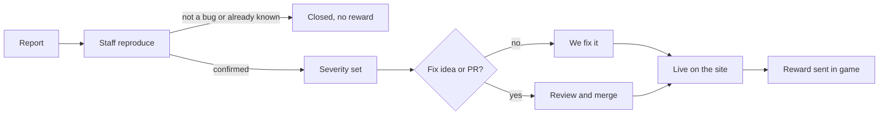

# Bug Bounty

Help us find and fix what is broken in Affairs & Order and **get paid in game cash**. Anyone with a nation can take part. A fix idea or a pull request earns a bigger reward.

## Rewards

Rewards are paid in **in-game gold**, sent to your nation.

| Severity | What it looks like | Base reward |
|---|---|---|
| **Cosmetic** | Typo, misaligned text, wrong icon | 50,000,000 |
| **Minor** | Wrong number or label on a page, dead link, small UI glitch | 2,500,000,000 |
| **Moderate** | A feature errors out (500 page), a calculation or formula is wrong | 1,000,000,000 |
| **Major** | Blocks normal play, breaks the economy, a war or the market | 2,500,000,000 |
| **Critical** | Duplicates money or resources, bypasses login or 2FA, exposes private data | 5,000,000,000 to 10,000,000,000 |

Staff set the severity after reproducing the bug. If you think it was rated too low, say why and we will look again.

## Fix bonuses

The more you help, the more you earn. Bonuses are a percentage of the base reward.

| What you provide | Bonus | Moderate bug pays |
|---|---|---|
| Clear, reproducible report | none | 1B |
| A **fix idea** that points at the cause (file, function or formula, and what to change) | **+50%** | 1.5B |
| A **pull request** that is reviewed and merged | **+100%** | 2B |
| That pull request includes a **regression test** | **+150%** | 2.5B |

Bonuses do not stack: you get the highest one that applies.

## What makes a good report

1. **Title** that says what broke ("Market: Max button buys more than I can afford").
2. **Steps to reproduce**, numbered, from a fresh page load.
3. **What you expected** and **what happened**.
4. **Evidence**: a screenshot, the page URL, your nation name, and the time (UTC).
5. Optional but paid: **your idea for the fix**.

Use the [bug report form](../../issues/new?template=bug_report.yml). You can also post in Discord and a mod will open the issue for you.

## How it works

Rewards are sent **after the fix is live**, normally within a few days. You will be pinged on the issue and in Discord.

## Rules

- **First valid report wins.** Duplicates are not paid. Check open issues and the [changelog](CHANGELOG.md) first.
- **It must be reproducible**, or at least well-evidenced.
- **Do not exploit it.** If you used a bug to gain money, resources or land before reporting it, that report is not eligible, and the gains are removed. Report it as soon as you find it.
- **Money and login bugs are private.** Do not post exploits in public channels or issues. Message a mod or follow [SECURITY.md](SECURITY.md). Public posting of a live exploit voids the reward.
- **One account per person.** Alt accounts do not earn extra rewards.
- **No attacking the live servers.** No load testing, scraping at scale, spamming, or touching other players' data.
- **Already known, by design, or wontfix** items are not paid. Balance opinions belong in the weekly vote.
- **Weekly cap:** 20,000,000,000 per person per week, so the economy stays healthy.
- **Staff decisions are final**, but we will always explain them.
- Rewards are game cash only and have no real-world value.

## Not a bug?

- Balance complaints ("this unit is too strong"): bring it to `#weekly-vote`.
- A feature idea: open an issue labelled `idea`. Good ideas that ship get a shout-out.
- Need help with gameplay: ask in `#ask-the-bot`.

## Hall of fame

Reporters who get a fix merged are credited in the [changelog](CHANGELOG.md) and announced in Discord. Want your name there? Send a PR.
