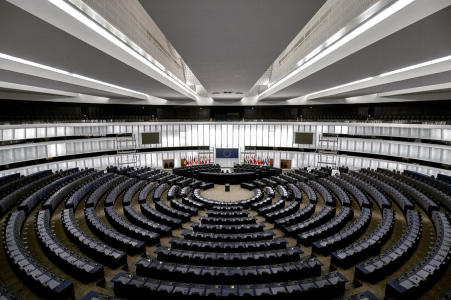
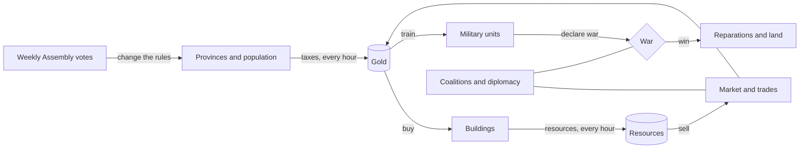
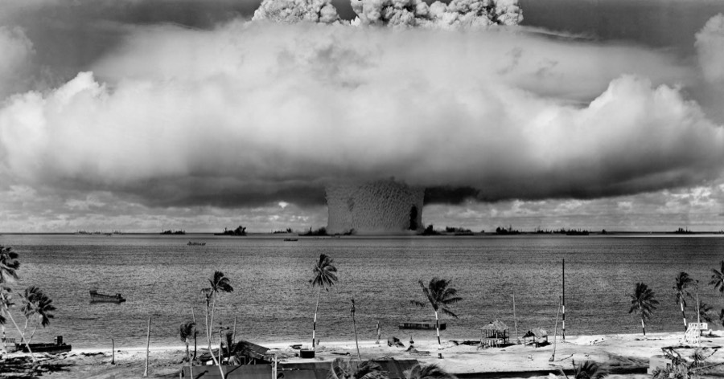
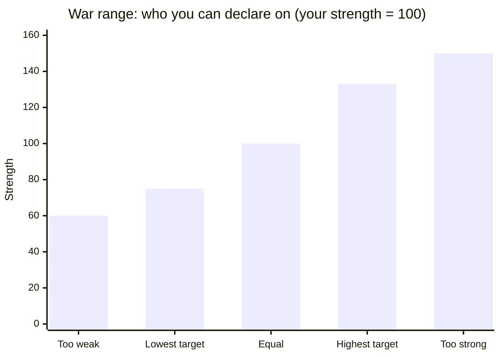
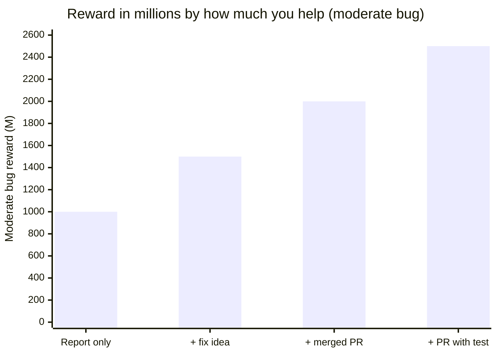
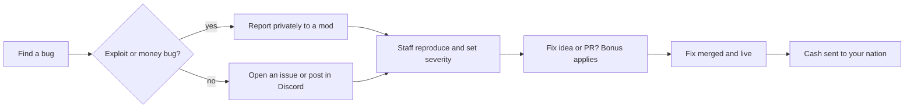
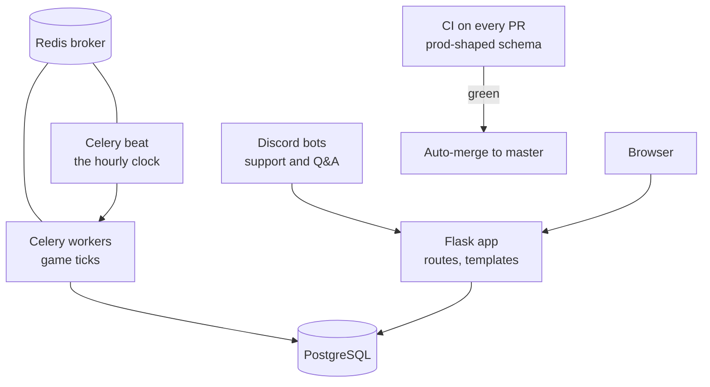

# Affairs & Order

**Build a nation. Run an economy. Forge alliances. Win wars.**
A free, browser-based nation simulation MMO, built in the open with its community.

[**Play now**](https://affairsandorder.org) · [**Join the Discord**](https://discord.gg/SEae3Ua) · [**Bug Bounty**](BOUNTIES.md) · [**Contribute**](CONTRIBUTING.md) · [**Game rules**](docs/GAME_RULES.md)

---

## You are welcome here

Affairs & Order is made by a small team and **shaped by the people who play it**. Every week the community votes on changes, and a good share of the fixes in our [changelog](CHANGELOG.md) started as a player saying "this looks wrong."

You do not need to be a programmer to help:

| If you are... | You can... | Start here |
|---|---|---|
| A **new player** | Ask anything. No question is too basic. | `#ask-the-bot` on Discord |
| A **veteran** | Answer questions, share builds, write a guide for your favourite strategy. | [Share your knowledge](#teach-and-share-tips) |
| A **bug hunter** | Report broken things and **get paid in game cash**. | [Bug bounty](#bug-bounty-get-paid-for-breaking-things) |
| A **tinkerer or developer** | Propose a fix, or open a PR, for a **bigger bounty**. | [CONTRIBUTING.md](CONTRIBUTING.md) |
| A **designer or writer** | Improve text, tooltips, tutorials and wiki pages. | Open an issue or message a mod |
| A **voter** | Shape the game in the weekly vote. | `#weekly-vote` on Discord |

---

## What is the game?

You rule a nation made of provinces. You decide what to build, what to trade, who to ally with and who to fight. The world keeps running while you are away: everything is driven by an **hourly clock** (see [the hourly cycle](#the-hourly-cycle)).

| Pillar | What you do |
|---|---|
| **Economy** | Build farms, mines, refineries, retail and more. Balance upkeep against income. |
| **Population** | Keep people fed, educated and happy. A happy, well-supplied nation pays more tax. |
| **Military** | Raise soldiers, tanks, aircraft, ships and missiles within your manpower cap. |
| **War** | Fight inside your strength range, spend action points, dig in, and negotiate peace. |
| **Diplomacy** | Form coalitions, set embargoes, trade, and vote in the Assembly. |

---

## The hourly cycle

Almost everything happens on the UTC clock. Knowing it explains most "why did my gold change?" questions.

```mermaid
gantt
    title What happens in each UTC hour
    dateFormat HH:mm
    axisFormat :%M
    section Income
    Taxes paid                :milestone, 00:00, 0m
    Building production + upkeep :milestone, 00:25, 0m
    Loan interest             :milestone, 00:40, 0m
    section World
    Resource consumption (every 10 min) :00:00, 10m
    Auto market orders        :milestone, 00:13, 0m
    Natural disasters         :milestone, 00:15, 0m
    Unit production           :milestone, 00:35, 0m
    Population growth         :milestone, 00:45, 0m
```

**Tip:** taxes land at **:00** and upkeep is charged at **:25**. Check your balance before :25 if you are close to zero.

---

## Tips from the rulebook

These come straight from [`docs/GAME_RULES.md`](docs/GAME_RULES.md), the document the code is tested against.

<b>Economy tips</b>

- **Consumer goods only reach people through retail buildings** in their province (food banks, gas stations, general stores, malls, distribution centers). With no retail, goods just sit in stock and you get no tax bonus.
- **Selling on the market escrows your goods** the moment you post the offer.
- **Trade fee is 5%**, or **2% between members of the same currency union**.
- **Embargoes** work at nation level and coalition level. Coalition leadership can enact them from the Actions tab.
- Every hourly payout is **claimed once per hour**, so nothing can pay or bill you twice.

<b>Population tips</b>

- A new province starts with **10,000 people** (6,000 working, 3,000 children, 1,000 elderly).
- Growth aims for a **nation-wide** comfort level, not a per-province one.
- Losing a battle or being hit by a nuke no longer freezes growth. Only actual deaths reduce population.
- Education capacity per building: primary **1,000**, high school **900**, university **5,000**.

<b>War tips</b>

- You can only declare war on nations whose strength is between **75% and 133%** of yours.
- Wars **end automatically after 7 days** as a white peace.
- Each war gives you separate **ground, air and naval action points**: start at 6, max 12, **+1 per hour**.
- Ground, air and naval attacks cost **3 AP**. Drone strikes, cruise missiles, **Dig In** and recon cost **2 AP**.
- **Dig In** gives **+10% ground defence per level**, up to **+30%** at level 3. Attacking resets it.
- Your army cannot exceed **10% of your working-age population** in manpower.

---

## Teach and share tips

The best resource a new player can have is a veteran who is willing to explain. If you know something, share it.

1. **Answer questions** in `#ask-the-bot` or the help channels. A short, friendly answer helps more than a perfect one.
2. **Explain the "why."** "Build retail" is okay. "Build retail because consumer goods only help people through retail in their province" teaches.
3. **Post your build.** A screenshot of a nation layout and a sentence on what it is good at helps everyone.
4. **Write a guide.** Open an issue titled `Guide: ...` or send it to a mod. Good guides get added to the tutorial and wiki.
5. **Welcome people.** The first day decides whether someone stays.

Spotted a wrong tooltip, outdated text or a confusing page? That counts too, and it is eligible for a [bounty](BOUNTIES.md).

---

## Bug bounty: get paid for breaking things

Found a bug? **We pay in game cash.** Propose a fix and **the reward grows.** Full rules are in [**BOUNTIES.md**](BOUNTIES.md).

| Severity | Example | Reward |
|---|---|---|
| Cosmetic | Typo, misaligned text | **50M** |
| Minor | Wrong number on a page, broken link | **250M** |
| Moderate | A feature errors out, a calculation is wrong | **1B** |
| Major | Blocks normal play, wrecks the economy or a war | **2.5B** |
| Critical | Duplicates money or resources, bypasses login | **5B to 10B** (report privately) |

| You provide | Bonus | Moderate bug total |
|---|---|---|
| A clear, reproducible report | base reward | 1B |
| ...plus a **fix idea** that points to the cause | **+50%** | 1.5B |
| ...plus a **pull request that gets merged** | **+100%** | 2B |
| ...plus a **regression test** in the PR | **+150%** | 2.5B |

**Quick rules:** first valid report wins, it has to be reproducible, and if you exploited a bug before reporting it you are not eligible. Details in [BOUNTIES.md](BOUNTIES.md).

[**Report a bug**](../../issues/new?template=bug_report.yml) · [**Suggest a fix**](CONTRIBUTING.md)

---

## Under the hood

For developers who want to look around. The code runs on **Flask** with **PostgreSQL**, **Celery + Redis** for the hourly clock, and is deployed on **Railway**.

| Where to look | What is there |
|---|---|
| [`docs/GAME_RULES.md`](docs/GAME_RULES.md) | What every mechanic must do, and the tests that enforce it |
| [`docs/SYSTEM_MAP.md`](docs/SYSTEM_MAP.md) | Generated map of every job, table and route |
| [`app_core/`](app_core) | Game logic: economy, market, population, military, ticks |
| [`wars/`](wars) | War ranges, action points, battles |
| [`tests/`](tests) | The test suite, including race-condition tests for double spends |
| [`CHANGELOG.md`](CHANGELOG.md) | What changed and when |

`master` is protected. Every change goes through a pull request and merges when CI passes. See [CONTRIBUTING.md](CONTRIBUTING.md) to run it locally.

---

## Security

Money bugs and login bugs are **never** posted publicly. See [SECURITY.md](SECURITY.md) for how to report them and still earn the top bounty.

## License

See [LICENSE](LICENSE).
